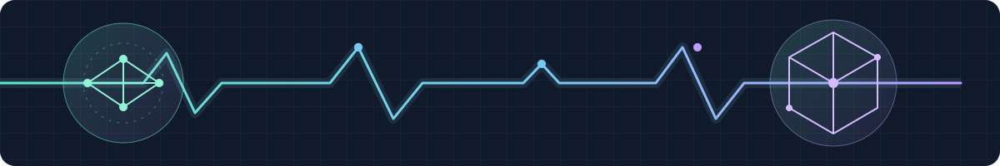

  

# Hi, I'm Michele Cerreto 👋

**Cloud & AI Enterprise Solution Architect at Microsoft · maker & builder · Caserta, Italy**

I like turning ambitious ideas into things you can actually use: cloud platforms, AI agents, developer tools, and hardware hacking that gives old devices a second life.

[LinkedIn](https://it.linkedin.com/in/michelecerreto) · [X @MikeCerreto](https://x.com/MikeCerreto) · [GitHub](https://github.com/MikeCer)

## My toolbelt

**Favorite languages & runtime**

  &nbsp;.NET ·
  &nbsp;C# ·
  &nbsp;Python ·
  &nbsp;JavaScript ·
  &nbsp;TypeScript ·
  &nbsp;C ·
  &nbsp;C++ ·
  &nbsp;Rust

**Platforms & practice**

  &nbsp;Azure ·
  &nbsp;Windows ·
  &nbsp;Linux

I bring Azure and broader Microsoft technology experience to cloud and AI work, alongside reverse-engineering and debugging expertise on both Windows and Linux.

## Things I've built

- **[Blender MCP extension](https://github.com/MikeCer/blender-mcp-extension)** — connects Copilot CLI to Blender for AI-assisted 3D modeling.
- **[Copilot plugins](https://github.com/MikeCer/copilot-plugins)** — a community marketplace for Copilot plugins.
- **[Azure TTE](https://github.com/MikeCer/azure_tte)** — Azure-native traffic management with a queue for high-traffic web events.
- **[VeloSync](https://github.com/MikeCer/velosync)** — indoor cycling video that adapts to your speed using BLE sensors or ESP8266 hardware.
- **[Anyka AK3918 Unchained](https://github.com/MikeCer/anyka-ak3918-unchained)** — a camera firmware rescue guide for restoring local RTSP/ONVIF access after vendor cloud services go away.

## Where curiosity takes me

A few threads from my [starred repositories](https://github.com/MikeCer?tab=stars) — inspiration and interests, **not a claim of contribution**:

- **Agents & context:** [Copilot SDK](https://github.com/github/copilot-sdk), [MCP servers](https://github.com/modelcontextprotocol/servers), [FastMCP](https://github.com/PrefectHQ/fastmcp), and [Mem0](https://github.com/mem0ai/mem0).
- **Local & multimodal AI:** [ggml](https://github.com/ggml-org/ggml), [SGLang](https://github.com/sgl-project/sglang), and [MediaPipe](https://github.com/google-ai-edge/mediapipe).
- **Cloud & the craft of running it:** [Apex](https://github.com/jonathan-vella/apex), [OpenSRE](https://github.com/Tracer-Cloud/opensre), and [Infisical](https://github.com/Infisical/infisical).
- **Making & the terminal:** [Fusion MCP](https://github.com/AutodeskFusion360/FusionMCPSample), [linux-surface](https://github.com/linux-surface/linux-surface), and [just](https://github.com/casey/just).

## Contributions beyond my repos

- **[Vibe-Trading](https://github.com/HKUDS/Vibe-Trading/pull/636)** — fixed IBKR quote hangs under parallel agent execution.
- **[PI-Buddy](https://github.com/gderossilive/PI-Buddy/pull/1)** — SRE agent diagnostic analysis; [follow-up](https://github.com/gderossilive/PI-Buddy/pull/3) improved Graph client logging and error handling.
- **[SharpRepository](https://github.com/SharpRepository/SharpRepository/pull/84)** — MongoDB primary-key automapping; [another fix](https://github.com/SharpRepository/SharpRepository/pull/80) addressed MongoDB query and delete methods.

Build something useful. Stay curious. Repeat. · Technology icons by <a href="https://github.com/devicons/devicon">Devicon</a> (<a href="assets/icons/LICENSE">MIT license</a>).
